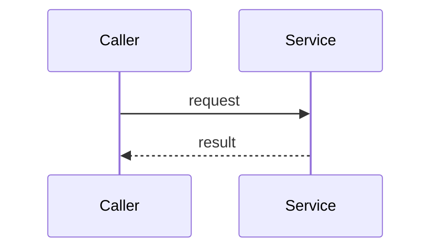

# PR descriptions

A PR description is a high-level summary. A reviewer reads it in under a minute and knows why the change exists, what it must achieve, how it works, why to trust it, and what could go wrong. Depth lives in the repo, in a committed doc the description links to, so it survives after the PR is merged and the description is forgotten.

Read this file completely before drafting. Run the `writing-style:output-brief` skill over the drafted description before presenting, committing, or pushing it. This is a pass over the text you wrote, every sentence and every diagram label, done after the draft exists. Diagram labels are prose: "lands", "surface", and glued jargon fail there too.

## The rule that sets the length

Put the reasoning a reviewer needs to approve the change in the description. Put everything a future maintainer needs in a committed doc. If you are explaining a tradeoff, a data model, an algorithm, or a migration in more than a short paragraph, stop: that belongs in a doc (see "When to write a doc"). Link it from the description and keep the description short.

Write every bullet as one short line that states a salient point at a high level: the behaviour, decision or risk, in words a reviewer recognises. Class, method, exception and metric names, field lists and test counts stay in the code and the linked doc; name one only when the point means nothing without it. For example, "A sent letter can no longer change; correcting it starts a new letter." rather than a bullet that lists the exception, its reason codes and the metric that counts it.

The description has five sections, in this order. Nothing else: no file inventory, no list of what each file changed, no conditions for later stories (the work items track those), and no boilerplate a repo template adds for reviewers, such as a review-label legend. Keep a template section only when a repo check reads it, such as a persona line or a checklist.

## The five sections

### 1. Why is the change needed

When the work comes from a plan doc (the tracking artifact that breaks a milestone into stories, such as a release breakdown), put a link to it on the first line of the description, above Why (a line naming the PR's place in a stack of PRs goes there too), for example `Tracking: [Release breakdown](<plan doc link>)`. A reviewer then sees where the story sits in the plan before reading anything else.

The problem or goal, in two or three sentences. Link the work item (`Resolves AB#<id>`). State the trigger: the bug, the member impact, the missing capability. No solution yet.

### 2. What must the change achieve: Intent

Every description has an Intent section, straight after Why. It is the first thing the reviewer judges the PR against, so the PR is measured against what it set out to do rather than against what it chose to claim.

State the intent in one sentence of plain text, not a quote block, which renders dimmed: the behaviour the change should make true, not the code it adds.

Then one sentence of prose that tells the reader what each bullet carries, for example "Each bullet below describes something the change does, explains why it serves that intent, and says how we validated it." Write it as a full sentence, not a clipped list such as "Each bullet: what, why, how validated."

Where the intent and its bullets come from:

- **The work item has an Intent and a "Metric: done when" list** (the story format the plan docs use): state its Intent, and cover every Metric bullet, in the ticket's order.
- **The work item has no Intent, or there is no work item:** gauge the intent the way the [intent-review](../intent-review/SKILL.md) skill's first phase does. Use the user's own words when they stated what the change is for; otherwise draft it from the work item, the commit messages and the conversation, and confirm it with the user in one question before publishing. Then write one bullet per behaviour the intent promises.

Write each bullet as `<behaviour>, so <why it matters for the intent>. Validated via <unit tests | component tests | e2e tests | manual testing on the PR deployment>.`

- The "so" clause is the point of the bullet: it tells the reviewer why this behaviour serves the intent. A bullet with no "so" clause is a feature list.
- Name the kind of validation that was actually done, not the test names. Test names belong in the code.
- No checkboxes. A behaviour the PR does not meet yet says so in the bullet, with what closes it, for example "Not met yet: needs infra#123 merged". It also appears under Risks.
- When the bullets serve different parts of the intent, group them under short bold headings that name the part, for example **Stopping a second run** and **Keeping the guard safe and visible**. Never refer to bullets by position ("the first four", "the last three").

After the bullets, add `## Decisions made during implementation`: one short bullet per choice the reviewer has to agree with that the work item did not settle, such as a Metric met differently on purpose, an option declined, or a default picked. Give the reason in the same line, and link where it was agreed when someone agreed it.

```markdown
# Intent

One run of a job happens once, however many messages arrive for it.

Each bullet below describes something the change does, explains why it serves that intent, and says how we validated it.

**Stopping a second run**

- Repeats and older runs' messages are dropped, which is what stops the second run. Validated via unit tests.
- The run is recorded with a conditional write, so two copies arriving together can't both start it. Validated via component tests.

**Keeping the guard safe and visible**

- A message with no run number still runs, so jobs in flight during the deploy aren't lost. Validated via unit tests.

## Decisions made during implementation

- The job queue keeps duplicate detection off: turning it on replaces the queue, so the handler drops repeats instead.
```

### 3. What is the general approach

The strategy in a few sentences, plus a diagram (see "Choosing diagrams"). This section also carries the decisions a reviewer has to agree with, one line each; there is no separate "what changed" section, because the diff already lists the files. The reviewer should grasp the shape of the solution before reading any prose about the parts. If the approach has a tradeoff worth recording, state the pick in one line and link the decision doc for the reasoning.

### 4. What are the risks

The salient risks of this change, one short bullet each, most serious first. Always cover:

- **Deploying:** what changes in production the moment this deploys: new writers or readers, extra queries, migrations, flags, and the order other components must deploy in.
- **Rolling back:** whether the previous version still reads everything this version may have written, and what breaks if not.
- Any other unmitigated risk or known gap, stated plainly, with what decides or closes it. A reviewer trusts an honest gap more than a silent one.

Leave out risks that belong to later stories; their work items track them.

### 5. How have we built confidence

Comes after Risks, and answers it: for each risk, how it was mitigated, or how it will be mitigated during rollout. One short bullet per risk, led by the risk's name in bold so the reviewer can pair it with its risk. No Gherkin scenarios, no test names, no test-run counts.

- **Regressions:** which suites pass, in one line, for example "the full unit and component suites pass". Where the repo requires a new test to be shown failing without the change, say that you did.
- **Deploying and rolling back:** what makes each safe (an additive field, an old path kept for messages in flight, the previous version ignoring a new field), and whether that was confirmed by a test or only from the code.
- **Risks left for rollout:** what to watch (the metric, its dimensions, the environment order), what "normal" looks like, and the signal that means roll back.
- **Steps still to do:** mark each "(not done yet)", for example a check on the PR deployment. When a step is done, change it to say what was run and what it showed, and say plainly when the evidence is partial (logs only, not the stored record).
- Anything a check on a real deployment surfaced that the tests did not, such as an extra write or a common race, with its cost. Also add it under Risks.

For a purely mechanical change, such as a rename or a config bump, write one line saying so instead.

## Choosing diagrams

Pick the diagram type from what the change touches. The approach section gets a diagram.

- **Interfaces, and where logic lives or runs** → class, component, or deployment diagram. Use when the change moves responsibility between classes or services, adds or reshapes an interface, or changes which process or host runs a piece of logic.
- **A workflow or a behaviour** → sequence or flow diagram. Use when the change alters the order of calls, a state machine, a decision path, or what happens across a request.
- **Both** → include more than one diagram. A change that adds a service (where) and reroutes a call sequence through it (behaviour) needs one of each.

Keep each diagram to the nodes that changed plus their immediate neighbours. A diagram that redraws the whole system hides the change. If the change is purely mechanical (a rename, a config bump) and a diagram would add nothing, write one line saying why there is no diagram instead of forcing one.

### Diagram mechanics

Use Mermaid in fenced ` ```mermaid ` blocks. GitHub renders these in the PR description directly. On ADO the PR description does not render Mermaid reliably, so commit the diagram in the linked doc and reference it from the description there.



Label every node and edge with a concrete name from the code. A box called "Service" teaches nothing; "PatientService" does. For a line break inside a label use `<br/>`; GitHub renders a literal `\n` as the two characters, not a break.

## When to write a doc

Write or extend a committed doc, and link it from the description, when any of these hold:

- The approach makes a significant decision about behaviour, architecture, or structure a future reader would question. → a short decision doc via the [decision-doc](../decision-doc/SKILL.md) skill.
- The change reshapes a component's behaviour or structure. → update that component's current-view architecture doc (`docs/architecture/`) so it reads as the present state, without replaying decisions.
- The change needs a whole new technical design (alternatives, system diagrams, the use-error/threat/privacy analyses). → the Technical Design Buddy skill, which produces the RFC.
- The explanation needs more than a short paragraph or more than two diagrams. → it belongs in one of the docs above, not the description.

The doc holds the depth: the decision and its reasoning, the schema, the sequence in full, the failure modes. The PR description holds the summary and one link. Check the target repo's convention for where docs live before creating a new location.

## Self-check before presenting

1. Does the description have the five sections (why, intent, approach, risks, confidence), in order, and nothing else? No "what changed" section, no conditions for later stories, no template boilerplate that no check reads.
2. Does Intent come straight after Why, with the intent as plain text, one prose sentence on what the bullets carry, and bullets in the form "<behaviour>, so <why>. Validated via <kind>.", grouped under headings when they serve different parts of the intent, with no checkboxes and no test names? Does every Metric bullet appear when the work item has them, and does "Decisions made during implementation" follow?
3. Is every block of reasoning longer than a short paragraph moved to a linked doc, and is every bullet one short, high-level line?
4. Does the approach section carry a diagram of the right type, with nodes named after real code and scoped to what changed (or one line saying why not)?
5. Do the risks come before confidence, and cover deploying and rolling back, plus any unmitigated gap?
6. Does "how have we built confidence" answer each risk with its mitigation or its rollout signal, mark unfinished steps "(not done yet)", and contain no Gherkin?
7. Have you run `writing-style:output-brief` over the finished draft, sentences and diagram labels both?

Fix every failure before showing the draft. The template in `templates/pr-body.template.md` is the shape to fill.
