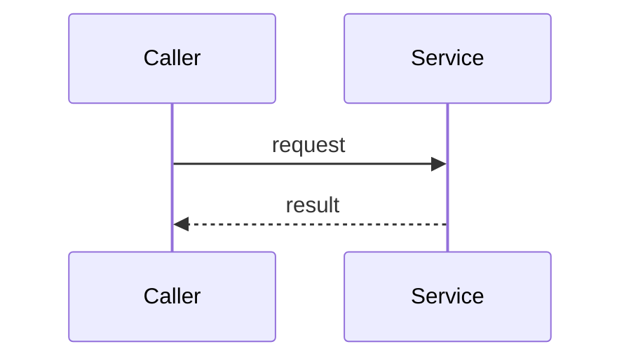

# PR descriptions

A PR description is a high-level summary. A reviewer reads it in under a minute and knows why the change exists, how it works, why to trust it, and what could go wrong. Depth lives in the repo, in a committed doc the description links to, so it survives after the PR is merged and the description is forgotten.

Read this file completely before drafting. Run the [writing-style](../writing-style/SKILL.md) hard rules over the drafted description before presenting, committing, or pushing it. This is a pass over the text you wrote, every sentence and every diagram label, done after the draft exists. Diagram labels are prose: "lands", "surface", and glued jargon fail there too.

## The rule that sets the length

Put the reasoning a reviewer needs to approve the change in the description. Put everything a future maintainer needs in a committed doc. If you are explaining a tradeoff, a data model, an algorithm, or a migration in more than a short paragraph, stop: that belongs in a doc (see "When to write a doc"). Link it from the description and keep the description short.

The description answers four questions, in this order. Nothing else: no file inventory, no list of what each file changed, no conditions for later stories (those live in the decision doc or on the work items), and no boilerplate a repo template adds for reviewers, such as a review-label legend. Keep a template section only when a repo check reads it, such as a persona line or a checklist.

## The four questions

### 1. Why is the change needed

When the work comes from a plan doc (the tracking artifact that breaks a milestone into stories, such as a release breakdown), put a link to it on the first line of the description, above Why, for example `Tracking: [Release breakdown](<plan doc link>)`. A reviewer then sees where the story sits in the plan before reading anything else.

The problem or goal, in two or three sentences. Link the work item (`Resolves AB#<id>`). State the trigger: the bug, the member impact, the missing capability. No solution yet.

#### Intent and Metric, when the work item has them

When the work item carries an Intent and a "Metric: done when" list (the story format the plan docs use), add an `## Intent` subsection under Why. Quote the Intent in one sentence, then give every Metric bullet as a checklist item, in the ticket's order, so the reviewer judges the PR against what the story promised rather than against what the PR chose to claim.

Keep each bullet to one line: the Metric in a few words, then its evidence.

- Tick a bullet only when the PR meets it, and name the evidence: the test class that pins it, a link, or a command and its result.
- Leave a bullet unticked when the PR does not meet it, with what closes it, for example a separate PR that must merge first.
- List departures after the checklist, one short bullet each, with a link to where they were agreed. A departure is a Metric the PR met differently on purpose, or an Optimizer preference the PR went against.

```markdown
## Intent

> Add the item classes, data access and serialization for the three order items.

- [x] Round-trip per type: `OrderItemSerializationTests`.
- [ ] Container exists on dev: needs infra#123 merged and released.

Departures, agreed on [AB#12345](link):
- `OutboxStatus` has no `Done`: finished entries are soft deleted.
```

### 2. What is the general approach

The strategy in a few sentences, plus a diagram (see "Choosing diagrams"). This section also carries the decisions a reviewer has to agree with, one line each; there is no separate "what changed" section, because the diff already lists the files. The reviewer should grasp the shape of the solution before reading any prose about the parts. If the approach has a tradeoff worth recording, state the pick in one line and link the decision doc for the reasoning.

### 3. How have we built confidence

Only the behaviours the tests pin, as Gherkin scenarios (Given, When, Then) in one fenced ` ```gherkin ` block, each followed by the test that pins it. No test-run counts, no list of tools that passed, no observability or rollout prose: a reviewer checks each claimed behaviour without reading test code, and spots a missing case by its absence. For a purely mechanical change, such as a rename or a config bump, write one line saying so instead of the block.

- Keep every scenario the plan promised, one behaviour per scenario. Do not cap the number; cases the plan did not promise belong in the test file.
- For a bug fix, the first scenario reproduces the reported failure in the terms of the report, and says whether its test failed before the fix.
- Write each scenario in domain and user terms, not method names. "When the user changes the filter before the first page loads" says more than "When LoadPage is called twice".
- A scenario can be one line when its title says it all; add Given, When, Then lines only where they add a fact.
- Follow each scenario with the test that pins it as a comment line, for example `# SearchResultsTests.FilterChange_DuringFirstLoad_DoesNotRestartQuery`. A scenario with no test is a gap: list it under Risks.

```gherkin
Scenario: A filter change while the first page loads does not restart the query
  Given the search results list has more than 20 rows
  When the user changes the filter to one with no matching rows before the first page appears
  Then the list shows no rows
  # SearchResultsTests.FilterChange_DuringFirstLoad_DoesNotRestartQuery
```

### 4. What are the risks

The salient risks of this change, one short bullet each, most serious first. Always cover:

- **Deploying:** what changes in production the moment this deploys: new writers or readers, extra queries, migrations, flags, and the order other components must deploy in.
- **Rolling back:** whether the previous version still reads everything this version may have written, and what breaks if not.
- Any other unmitigated risk or known gap, stated plainly, with what decides or closes it. A reviewer trusts an honest gap more than a silent one.

Leave out risks that belong to later stories; those live in the decision doc or on their work items.

## Choosing diagrams

Pick the diagram type from what the change touches. The approach section gets a diagram.

- **Interfaces, and where logic lives or runs** → class, component, or deployment diagram. Use when the change moves responsibility between classes or services, adds or reshapes an interface, or changes which process or host runs a piece of logic.
- **A workflow or a behaviour** → sequence or flow diagram. Use when the change alters the order of calls, a state machine, a decision path, or what happens across a request.
- **Both** → include more than one diagram. A change that adds a service (where) and reroutes a call sequence through it (behaviour) needs one of each.

Keep each diagram to the nodes that changed plus their immediate neighbours. A diagram that redraws the whole system hides the change. If the change is purely mechanical (a rename, a config bump) and a diagram would add nothing, write one line saying why there is no diagram instead of forcing one.

### Diagram mechanics

Use Mermaid in fenced ` ```mermaid ` blocks. GitHub renders these in the PR description directly. On ADO the PR description does not render Mermaid reliably, so commit the diagram in the linked doc and reference it from the description there.



Label every node and edge with a concrete name from the code. A box called "Service" teaches nothing; "PatientService" does. For a line break inside a label use `<br/>`; GitHub renders a literal `\n` as the two characters, not a break.

## When to write a doc

Write or extend a committed doc, and link it from the description, when any of these hold:

- The approach makes a significant decision about behaviour, architecture, or structure a future reader would question. → a short decision doc via the [decision-doc](../decision-doc/SKILL.md) skill.
- The change reshapes a component's behaviour or structure. → update that component's current-view architecture doc (`docs/architecture/`) so it reads as the present state, without replaying decisions.
- The change needs a whole new technical design (alternatives, system diagrams, the use-error/threat/privacy analyses). → the Technical Design Buddy skill, which produces the RFC.
- The explanation needs more than a short paragraph or more than two diagrams. → it belongs in one of the docs above, not the description.

The doc holds the depth: the decision and its reasoning, the schema, the sequence in full, the failure modes. The PR description holds the summary and one link. Check the target repo's convention for where docs live before creating a new location.

## Self-check before presenting

1. Does the description answer the four questions (why, approach, confidence, risks), in order, and nothing else? No "what changed" section, no conditions for later stories, no template boilerplate that no check reads.
2. If the work item has an Intent and a Metric, does Why carry the checklist with every Metric bullet, one line each, ticked with evidence or unticked with what closes it, and the departures listed with links?
3. Is every block of reasoning longer than a short paragraph moved to a linked doc?
4. Does the approach section carry a diagram of the right type, with nodes named after real code and scoped to what changed (or one line saying why not)?
5. Is "how have we built confidence" only the Gherkin block, with every promised scenario and the test that pins each?
6. Do the risks cover deploying and rolling back, plus any unmitigated gap?
7. Have you run the writing-style hard rules over the finished draft, sentences and diagram labels both?

Fix every failure before showing the draft. The template in `templates/pr-body.template.md` is the shape to fill.
